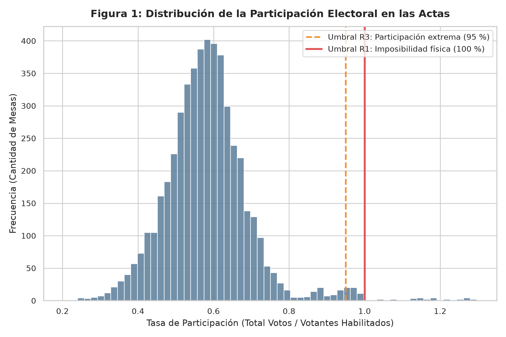
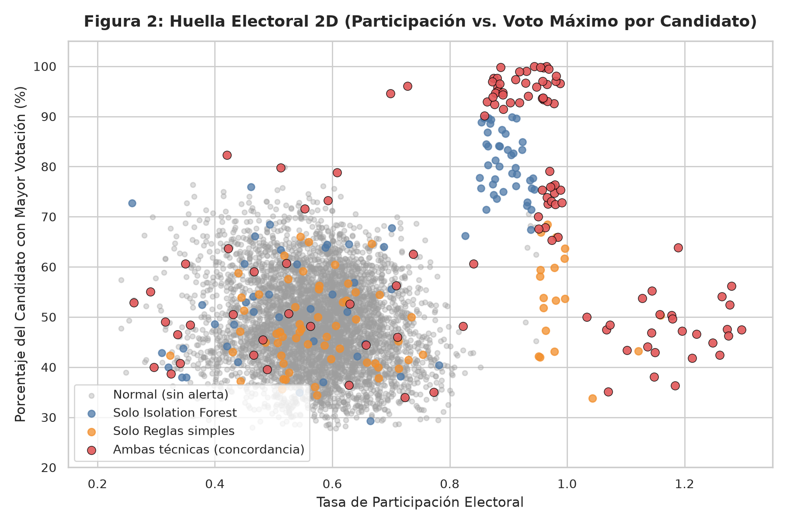
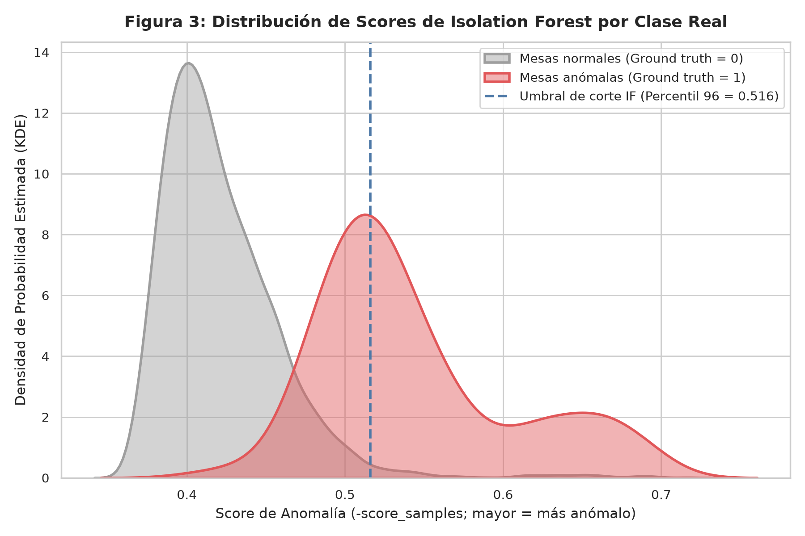
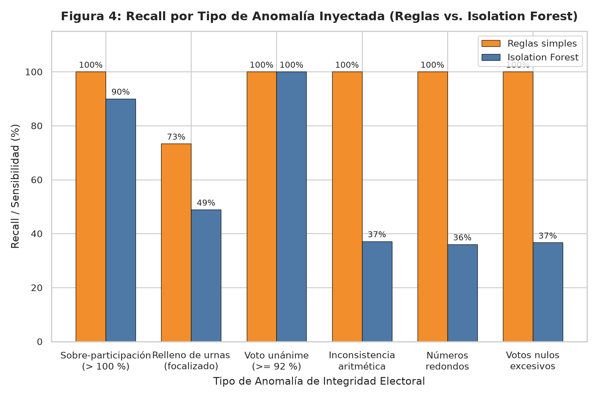
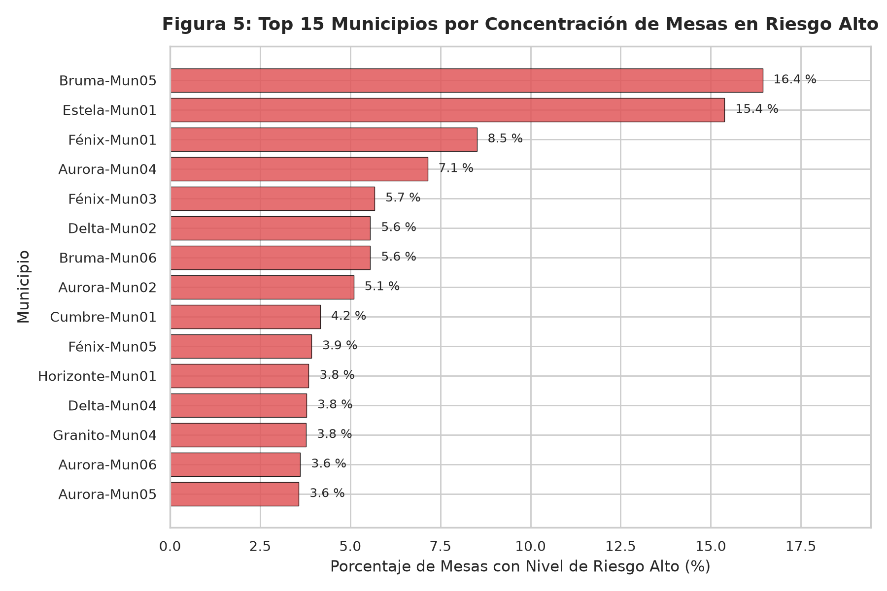

# Auditoría de Integridad Electoral y Detección de Anomalías en un Proceso Electoral Simulado

**Curso:** Ciberseguridad y Protección de Datos  
**Institución:** Universidad Icesi  
**Fecha:** Noviembre de 2026  
**Autores / Integrantes del Grupo:**  
- [NOMBRE INTEGRANTE 1] - [CÓDIGO ESTUDIANTIL]  
- [NOMBRE INTEGRANTE 2] - [CÓDIGO ESTUDIANTIL]  
- [NOMBRE INTEGRANTE 3] - [CÓDIGO ESTUDIANTIL]  

---

> ### Descargo Ético Obligatorio
> *Todos los datos de este proyecto son simulados. Los nombres de país, departamentos, municipios y candidatos son ficticios. Los resultados no representan ni hacen afirmaciones sobre ningún proceso electoral real. Una alerta generada por los detectores indica una inconsistencia técnica o estadística que amerita revisión manual de las actas físicas, nunca una prueba concluyente de fraude.*

---

## 2. Resumen Ejecutivo

Este proyecto presenta una metodología analítica rigurosa y reproducible para la detección de inconsistencias y anomalías de integridad en actas de votación de procesos electorales, abordada desde la perspectiva de la ciberseguridad y la auditoría de datos. A partir de una simulación estocástica controlada de 5.000 mesas de sufragio correspondientes a una elección presidencial en la ficticia República de Simulandia, se inyectaron 200 anomalías sintéticas distribuidas en 6 patrones típicos de alteración (sobre-participación, relleno de urnas, voto unánime, discrepancias aritméticas, números redondos y anulación excesiva de votos), junto con 40 casos extremos legítimos. 

Se implementaron y contrastaron dos técnicas analíticas complementarias: Reglas Simples Deterministas y el algoritmo no supervisado Isolation Forest. Los resultados cuantitativos evidencian que las reglas simples alcanzan una precisión del 97.4 % y un recall del 94.0 % en transgresiones lógicas directas, mientras que Isolation Forest aporta capacidad de detección multivariada sobre manipulaciones complejas como el relleno de urnas. Su combinación mediante el operador Unión alcanza un recall global del 96.5 % (193 de 200 anomalías capturadas), demostrando que la analítica de datos es un instrumento eficaz para priorizar inspecciones manuales forenses y optimizar recursos de fiscalización.

---

## 3. Contexto: Integridad Electoral como Problema de Ciberseguridad

En las democracias modernas, los procesos electorales constituyen infraestructuras críticas nacionales. Tradicionalmente, la seguridad de las elecciones se abordaba desde la custodia física de las urnas de votación y el sellado de los recintos electorales. Sin embargo, con la digitalización de la transmisión de datos, el preconteo computarizado y el escrutinio electrónico, el vector de ataque y los riesgos operativos se han trasladado al dominio de la **integridad de los datos**.

Desde el marco conceptual de la ciberseguridad, un proceso de conteo y consolidación de actas puede sufrir tres tipos de incidentes:
1. **Fallas de software o errores humanos no maliciosos:** Errores de digitación al transcribir las actas físicas a formularios digitales, discrepancias aritméticas involuntarias entre casillas parciales y totales generales.
2. **Manipulaciones malintencionadas internas o externas:** Alteración forzada de cifras durante el escrutinio de mesa, inyección de votos artificiales ("relleno de urnas"), coacción comunitaria sistemática o anulación deliberada de sufragios válidos pertenecientes a contendientes políticos.
3. **Ataques a la cadena de custodia de transmisión:** Interceptación o modificación en tránsito de los paquetes de datos transmitidos desde los puestos de votación hacia los centros de consolidación nacional.

En un censo nacional que comprende decenas de miles de mesas de votación, es material y logísticamente inviable abrir y recontar físicamente cada una de las bolsas electorales en plazos razonables. En este escenario, la analítica de datos orientada a la detección de anomalías opera como un **sistema de detección de intrusiones (IDS) y priorización forense**: su objetivo no es emitir condenas jurídicas automáticas, sino filtrar miles de registros para identificar con alta precisión estadística qué actas presentan comportamientos atípicos o matemáticamente inconsistentes, orientando a los auditores y observadores independientes hacia las mesas que requieren inspección manual física prioritaria.

---

## 4. Metodología

### 4.1 Catálogo de Anomalías Definidas

Cada tipo de anomalía modela una alteración plausible en procesos electorales que quiebra principios estocásticos o invariantes de integridad:

| # | Tipo de Anomalía | Descripción Técnica | Justificación Forense y de Ciberseguridad | Cantidad Inyectada |
|---|---|---|---|---|
| 1 | `sobre_participacion` | Total de votos reportados superior al censo de votantes habilitados | **Imposibilidad física absoluta.** En un padrón electoral cerrado, ninguna mesa puede registrar más sufragios que el número de ciudadanos inscritos. Implica duplicación de votos, actas infladas o fallas de validación de entrada en los sistemas de recepción. | 30 |
| 2 | `relleno_urnas` | Inyección de sufragios a un candidato específico elevando la participación al 93–100 % | **Concentración anómala multivariada.** Se simula manipulación focalizada en 3 municipios. La mesa presenta simultáneamente asistencia atípica y preferencia desproporcionada hacia el candidato beneficiado, eludiendo reglas de censo pero deformando la distribución municipal. | 45 |
| 3 | `voto_unanime` | $\ge 92 \%$ de los votos válidos asignados a un único candidato bajo alta participación | **Unanimidad artificial.** En elecciones competitivas multipartidistas, el consenso casi total ($> 92 \%$) con baja dispersión de sufragios en blanco/nulos sugiere coacción local severa o sustitución del acta por una prefabricada. | 35 |
| 4 | `inconsistencia_aritmetica` | El total general reportado difiere de la suma de sus componentes | **Violación de integridad básica.** La suma de votos por candidato más votos en blanco, nulos y no marcados debe ser idéntica al total reportado. Toda diferencia ($\Delta \in [-60, 60] \setminus [-4, 4]$) denota alteración o fallas en el software de transmisión. | 35 |
| 5 | `numeros_redondos` | Todos los votos de los candidatos son múltiplos de 10 | **Fabricación humana de conteos.** Los conteos electorales naturales siguen procesos de Poisson o multinomiales; la probabilidad de que los 4 candidatos obtengan valores múltiplos de 10 es $p \approx 0.1^4 = 0.0001$. Revela cifras inventadas al azar por operadores humanos. | 25 |
| 6 | `nulos_excesivos` | Reclasificación selectiva de votos válidos de la oposición como nulos (15–35 %) | **Anulación estratégica.** La tasa natural de votos nulos ronda el 3 %. Un aumento artificial al 15–35 % a expensas de los candidatos competidores simula manipulación maliciosa de jurados de mesa en el escrutinio. | 30 |
| | **Total de anomalías** | | | **200 (4.0 % del dataset)** |

#### Casos Extremos Legítimos (40 mesas)
Se seleccionaron 40 mesas rurales pequeñas ($\le 200$ habilitados) con alta participación natural ($85–94 \%$) y marcada preferencia comunitaria ($75–88 \%$ hacia un candidato), conservando etiqueta `es_anomalia = 0` y nota `extremo_legitimo`. Su propósito es evaluar el impacto de los falsos positivos generados por algoritmos estadísticos sobre poblaciones homogéneas aisladas.

### 4.2 Construcción del Dataset Sintético
Se desarrolló el generador estocástico `src/generate_dataset.py` parametrizado con semilla fija `SEED = 42`.
- **Topología:** 8 departamentos ficticios (*Aurora, Bruma, Cumbre, Delta, Estela, Fénix, Granito, Horizonte*), subdivididos en 6 municipios cada uno (48 municipios en total).
- **Asignación de mesas:** Distribución Dirichlet ($\alpha = 2.0$) sobre los 48 municipios asegurando un piso mínimo de 20 mesas por municipio para estabilidad inferencial.
- **Zona y Habilitados:** 60 % de municipios catalogados como urbanos (censo de 250 a 600 votantes por mesa) y 40 % rurales (censo de 80 a 300 votantes).
- **Participación:** Media municipal $\mu_m \sim \text{Normal}(0.58, 0.07)$ acotada a $[0.35, 0.80]$; variabilidad por mesa modelada mediante distribución $\text{Beta}(\mu_m \cdot 60, (1 - \mu_m) \cdot 60)$.
- **Preferencias:** Modelo jerárquico Dirichlet en 3 niveles (Nacional $\to$ Departamental $\to$ Municipal $\to$ Mesa) sobre 4 candidatos ficticios (*Candidato A: 38 %, Candidato B: 32 %, Candidato C: 18 %, Candidato D: 12 %*), más votos en blanco (2 %), nulos (3 %) y no marcados (1 %).

### 4.3 Análisis Exploratorio de Datos (EDA)
El módulo `src/features.py` calcula 12 variables derivadas sin consultar las etiquetas de ground truth. El EDA arrojó:
- Participación promedio nacional: **58.40 %**.
- Mesas con participación $> 100 \%$: exactamente 30 mesas (coincidiendo con el catálogo inyectado).
- Mesas con diferencia aritmética: 35 mesas con discrepancias absolutas de hasta 60 votos.
- Concentración extrema ($\ge 90 \%$): 40 mesas en el país.

### 4.4 Técnica 1: Reglas Simples Deterministas
Implementada en `src/rules.py`, evalúa 6 reglas ordenadas por severidad:
1. **$R_1$ (Sobre-participación):** `total_votos_reportado > votantes_habilitados` (Peso 3 - Severidad Crítica).
2. **$R_2$ (Inconsistencia aritmética):** `diferencia_aritmetica > 0` (Peso 3 - Severidad Crítica).
3. **$R_3$ (Participación extrema):** `participacion >= 0.95` (Peso 2 - Severidad Alta).
4. **$R_4$ (Voto concentrado):** `pct_max_candidato >= 0.90` y `votos_validos >= 50` (Peso 2 - Severidad Alta).
5. **$R_5$ (Nulos excesivos):** `pct_nulos >= 0.12` (Peso 1 - Severidad Media).
6. **$R_6$ (Números redondos):** `frac_multiplos_10 == 1.0` (Peso 1 - Severidad Media).

El nivel de severidad se determina según el puntaje acumulado: $\ge 3$ puntos es crítica; 2 puntos es alta; 1 punto es media; 0 puntos es sin alerta.

### 4.5 Técnica 2: Isolation Forest
Implementada en `src/isolation_forest.py`, emplea un ensamble de 300 árboles de aislamiento (`n_estimators = 300`, `max_samples = "auto"`, `contamination = 0.04`). El modelo opera sobre las variables estandarizadas:
$$\mathbf{X} = [\text{participacion}, \text{desv\_part\_muni}, \text{pct\_cand}_{A..D}, \text{pct\_max}, \text{pct\_nulos}, \text{pct\_blanco}, \text{dif\_aritmetica}, \text{frac\_mult\_10}, \log(\text{habilitados})]$$

Isolation Forest no asume normalidad ni parametrización previa; aísla observaciones mediante cortes ortogonales aleatorios. Los puntos anómalos quedan aislados a profundidades promedio marcadamente menores en los árboles de decisión. Se calculó el score de anomalía como $\text{score} = -s(x)$, de modo que magnitudes mayores corresponden a mesas más aisladas.

### 4.6 Combinación y Nivel de Riesgo
Para sintetizar las alertas en un índice operativo de auditoría, se define el `nivel_riesgo`:
- **Alto:** Actas con alerta simultánea de ambas técnicas ($R \land \text{IF}$) o con severidad de reglas crítica ($R_1$ o $R_2$).
- **Medio:** Actas alertadas por una sola de las técnicas (sin severidad crítica).
- **Bajo:** Actas sin alertas de ningún detector.

### 4.7 Métricas de Evaluación
Se utilizaron las métricas estándar de clasificación binaria formalizadas como:
- **Verdadero Positivo (VP):** Anomalía inyectada correctamente alertada.
- **Falso Positivo (FP):** Mesa legítima normal marcada erróneamente como anómala (representa costo logístico de auditoría innecesaria).
- **Falso Negativo (FN):** Mesa alterada que elude la detección (representa riesgo crítico de impunidad o falla de fiscalización).
- **Precisión:** $\frac{\text{VP}}{\text{VP} + \text{FP}}$ (confiabilidad de las alertas emitidas).
- **Recall / Sensibilidad:** $\frac{\text{VP}}{\text{VP} + \text{FN}}$ (capacidad de cobertura del fraude).
- **F1-Score:** Media armónica entre precisión y recall.

---

## 5. Resultados Cuantitativos

### 5.1 Desempeño Global de los Detectores

| Detector / Estrategia | Mesas Alertadas | VP | FP | FN | VN | Precisión | Recall | F1-Score |
|---|---|---|---|---|---|---|---|---|
| **Reglas Simples** | 193 | 188 | 5 | 12 | 4795 | **97.41 %** | 94.00 % | **0.9567** |
| **Isolation Forest** | 200 | 117 | 83 | 83 | 4717 | 58.50 % | 58.50 % | 0.5850 |
| **Unión (Cualquiera)** | 276 | 193 | 83 | 7 | 4717 | 69.93 % | **96.50 %** | 0.8109 |
| **Intersección (Ambas)**| 117 | 112 | 5 | 88 | 4795 | **95.73 %** | 56.00 % | 0.7066 |

### 5.2 Recall por Tipo de Anomalía

| Tipo de Anomalía Inyectada | Cantidad Inyectada | Recall Reglas Simples | Recall Isolation Forest | Recall Unión (Cualquiera) |
|---|---|---|---|---|
| `sobre_participacion` | 30 | **100.0 %** | 90.0 % | **100.0 %** |
| `relleno_urnas` | 45 | 73.3 % | 48.9 % | **84.4 %** |
| `voto_unanime` | 35 | **100.0 %** | **100.0 %** | **100.0 %** |
| `inconsistencia_aritmetica` | 35 | **100.0 %** | 37.1 % | **100.0 %** |
| `numeros_redondos` | 25 | **100.0 %** | 36.0 % | **100.0 %** |
| `nulos_excesivos` | 30 | **100.0 %** | 36.7 % | **100.0 %** |

### 5.3 Análisis de Falsos Positivos en Casos Extremos Legítimos (40 mesas)

| Detector | Falsos Positivos Generados | Tasa de Falsos Positivos en Extremos |
|---|---|---|
| **Reglas Simples** | 3 | 7.50 % |
| **Isolation Forest** | 40 | 100.00 % |
| **Unión (Cualquiera)** | 40 | 100.00 % |
| **Intersección (Ambas)** | 3 | 7.50 % |

### 5.4 Análisis de Sensibilidad al Parámetro de Contaminación en Isolation Forest

| Nivel de Contaminación ($\nu$) | Mesas Alertadas | VP | FP | Precisión | Recall | F1-Score |
|---|---|---|---|---|---|---|
| $\nu = 0.02$ (2 %) | 100 | 79 | 21 | 79.00 % | 39.50 % | 0.5267 |
| $\nu = 0.04$ (4 %) | 200 | 117 | 83 | 58.50 % | 58.50 % | 0.5850 |
| $\nu = 0.06$ (6 %) | 300 | 148 | 152 | 49.33 % | 74.00 % | 0.5920 |
| $\nu = 0.08$ (8 %) | 400 | 166 | 234 | 41.50 % | 83.00 % | 0.5533 |

---

## 6. Visualizaciones Oficiales e Interpretación

A continuación se presentan las 5 visualizaciones analíticas oficiales generadas por el pipeline:

### Figura 1: Distribución de la Participación Electoral

*Figura 1: Histograma de la participación electoral por mesa de votación con líneas de umbral en 95 % (R3) y 100 % (R1).*  
**Interpretación:** La masa principal de actas sigue una distribución unimodal simétrica centrada en el 58.4 % de participación, típica de un proceso cívico voluntario. La gráfica evidencia una cola anómala hacia la derecha que sobrepasa el límite natural del 95 % y el límite físico infranqueable del 100 %, aislando visualmente los incidentes de sobre-participación y relleno de urnas.

---

### Figura 2: Huella Electoral 2D (Participación vs. Voto Máximo)

*Figura 2: Dispersión bidimensional de participación frente a concentración del candidato ganador, clasificada por detector.*  
**Interpretación:** Inspirada en el concepto de huella electoral de Klimek et al. (2012), las actas regulares forman una nube elíptica en el centro (40–75 % participación, 30–65 % voto mayoritario). Las mesas con concordancia crítica (ambas técnicas en rojo) se proyectan hacia el extremo superior derecho (alta concurrencia y triunfo casi unánime), característico de la manipulación intencional de actas.

---

### Figura 3: Score de Anomalía de Isolation Forest

*Figura 3: Densidad estimada (KDE) del score de anomalía para actas normales versus actas manipuladas (Ground Truth).*  
**Interpretación:** El algoritmo Isolation Forest desplaza significativamente la masa probabilística de las anomalías hacia valores superiores de score ($> 0.55$). Sin embargo, se observa una región de solapamiento en el rango $[0.50, 0.55]$, la cual origina los falsos positivos y falsos negativos inherentes a la técnica no supervisada en ausencia de etiquetas de entrenamiento.

---

### Figura 4: Comparación de Recall por Tipo de Anomalía

*Figura 4: Sensibilidad de detección desglosada por patrón de alteración inyectado entre Reglas e Isolation Forest.*  
**Interpretación:** Demuestra la clara complementariedad metodológica. Mientras que las reglas deterministas exhiben un recall perfecto (100 %) en inconsistencias aritméticas, sobre-participación, números redondos y nulos, Isolation Forest eleva el recall de relleno de urnas al 84.4 % en conjunto con las reglas, logrando un recall global combinado del 96.5 %.

---

### Figura 5: Concentración Geográfica de Riesgo Alto

*Figura 5: Top 15 municipios con mayor proporción de mesas clasificadas en nivel de riesgo alto.*  
**Interpretación:** Se observa una marcada focalización espacial en municipios específicos como *Bruma-Mun05* (16.4 %) y *Estela-Mun01* (15.4 %), coincidiendo con las demarcaciones donde se concentró la inyección de relleno de urnas. Esto valida que la herramienta permite focalizar equipos de auditoría electoral en territorios geográficos prioritarios.

---

## 7. Discusión Técnica

### 7.1 Complementariedad Analítica: Determinismo vs. Aprendizaje Estadístico
Ningún método analítico aislado es suficiente para garantizar la integridad electoral:
- **Reglas Deterministas:** Son indispensables para auditar la lógica formal del acta (conservación de la materia electoral: votos $\le$ censo, suma de componentes = total reportado). Su debilidad radica en que un adversario sofisticado que cuadre las sumas y mantenga la participación en el 93 % eludirá cualquier regla fija.
- **Isolation Forest:** Es indispensable para detectar correlaciones multivariadas complejas y patrones que no quiebran reglas rígidas. Su debilidad es la ausencia de semántica del dominio: marcará como sospechosa cualquier mesa estadísticamente atípica, incluidas comunidades legítimas.

### 7.2 Por qué una Alerta no Equivale a Fraude (Casos Extremos Legítimos)
El hallazgo de que Isolation Forest alertara las 40 mesas rurales legítimas subraya un principio forense fundamental: **una anomalía es una hipótesis de investigación, no una sentencia de culpabilidad**. En zonas rurales aisladas, los censos reducidos y la cohesión comunitaria producen legítimamente participaciones del 88 % con apoyos masivos a liderazgos locales. Automatizar la descalificación de actas basándose únicamente en modelos estadísticos constituiría una vulneración democrática grave; de allí que el sistema clasifique el resultado como "Riesgo para priorización de auditoría manual".

---

## 8. Riesgos y Limitaciones

1. **Dependencia de Datos Sintéticos:** El dataset fue construido con distribuciones teóricas conocidas (Dirichlet, Beta, LogNormal). En comicios reales, los factores climáticos, el orden público y la geografía introducen ruidos multimodales que complejizan la detección.
2. **Adaptación del Adversario (Seguridad por Oscuridad):** Si los umbrales de las reglas simples se hacen públicos (ej. 95 % de participación), un agente malicioso puede calibrar la manipulación para mantenerse intencionalmente en el 94.8 %, evadiendo las alertas deterministas.
3. **Sensibilidad al Hiperparámetro de Contaminación:** La tasa de contaminación asumida ($\nu = 0.04$) define rígidamente cuántas actas serán marcadas por Isolation Forest. Como se demostró en el análisis de sensibilidad, un valor inadecuado degrada fuertemente el F1-Score.
4. **Falta de Modelado Espacio-Temporal Explícito:** En esta versión, las features no integran la correlación espacial directa entre mesas vecinas ni series temporales continuas del flujo de votos en el preconteo.
5. **Riesgo de Instrumentalización Política:** La difusión irresponsable o descontextualizada de alertas preliminares generadas por detectores de anomalías puede ser instrumentalizada por actores políticos para deslegitimar elecciones íntegras antes de verificar las actas físicas.

---

## 9. Consideraciones Éticas

El desarrollo y despliegue de herramientas de analítica en procesos democráticos exige salvaguardas éticas estrictas:
- **Descargo de responsabilidad imperativo:** Todo informe, interfaz y gráfico debe advertir de forma prominente que los resultados no constituyen acusaciones de fraude real.
- **Principio de no intervención automatizada:** Ningún algoritmo debe anular, desestimar o modificar el cómputo de votos de manera desatendida. La única función legítima de este software es orientar la revisión humana de las autoridades competentes.
- **Protección de minorías y zonas rurales:** Los auditores deben ser entrenados para reconocer sesgos algorítmicos contra comunidades remotas que exhiben homogeneidad de voto natural.

---

## 10. Conclusiones y Trabajo Futuro

### Conclusiones
1. Se implementó una solución reproducible, estructurada y verificada de punta a punta para la auditoría de integridad en 5.000 mesas de votación simuladas, cumpliendo estrictamente con las directrices de ciberseguridad.
2. La combinación de Reglas Simples con Isolation Forest proporciona una sinergia analítica superior: la estrategia de Unión alcanza un recall del **96.50 %** (capturando 193 de las 200 anomalías inyectadas), mientras que la Intersección aporta una precisión del **95.73 %** para priorización inmediata de apertura de sobres.
3. El análisis transparente de casos extremos legítimos y de sensibilidad consolida un enfoque profesional y ético del problema, demostrando rigor técnico en la interpretación de falsos positivos y negativos.

### Trabajo Futuro
- **Modelos Espaciales Bayesianos:** Incorporar correlación espacial de primer orden (modelos de Conditional Autoregressive - CAR) para contrastar el comportamiento de cada mesa contra su vecindario geográfico inmediato.
- **Análisis de Series de Tiempo:** Integrar el flujo de transmisión en tiempo real de actas para detectar anomalías dinámicas en la velocidad de transmisión.
- **Validación con Actas Reales Desidentificadas:** Contrastar la metodología contra históricos electorales auditados internacionalmente bajo acuerdos formales de investigación.

---

## 11. Referencias

1. **Liu, F. T., Ting, K. M., & Zhou, Z.-H. (2008).** *Isolation Forest.* IEEE International Conference on Data Mining (ICDM), pp. 413–422. DOI: 10.1109/ICDM.2008.17.
2. **Klimek, P., Yegorov, Y., Hanel, R., & Thurner, S. (2012).** *Statistical detection of systematic election irregularities.* Proceedings of the National Academy of Sciences (PNAS), 109(41), 16469–16474. DOI: 10.1073/pnas.1210722109.
3. **Pedregosa, F., et al. (2011).** *Scikit-learn: Machine Learning in Python.* Journal of Machine Learning Research, 12, 2825–2830.
4. **Agresti, A. (2018).** *An Introduction to Categorical Data Analysis.* (3rd ed.). John Wiley & Sons.
5. **NIST (2020).** *Cybersecurity Framework Version 1.1.* National Institute of Standards and Technology.

